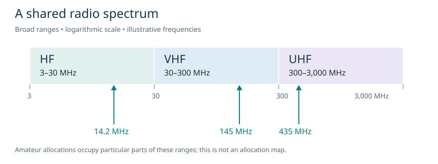
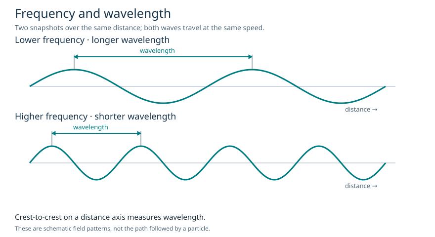

# Week 1 learner guide

## 1. A radio conversation starts with a few choices

Imagine two RARS members want to speak to each other from different places around campus. Before touching the transmit button, they need to agree where to listen and how to communicate. They also need permission to transmit there.

Three words will help you make sense of almost every radio conversation:

| Word | Meaning | Example |
| --- | --- | --- |
| Frequency | How quickly a signal repeats | A display reading 145.500 MHz |
| Band | A range of frequencies | The amateur 2-metre band |
| Mode | How the information is carried | FM voice |

The display example is for learning vocabulary. Choosing an actual channel also involves your licence, the current band plan and listening for existing users. We will practise those operating decisions later.

## 2. What is amateur radio?

Amateur radio, often called **ham radio**, lets people learn about radio by using it. You might build an antenna, compare signals, speak to another operator or exchange information between computers over a radio link.

The amateur licence is for personal learning, technical investigation and leisure. It is not a business radio licence: business traffic and commercial advertising are outside its purpose. [Ofcom source: S4 in the source notes.]

You do not need to arrive as an electronics expert. Foundation is the starting level. The usual progression is **Foundation, Intermediate, Full**, with further study building on the earlier level.

People enjoy different parts of the hobby. A **net** is an organised on-air group conversation. A **contest** is an activity with rules for making and recording contacts. **DX** refers to distant contacts. A **QSL** is a confirmation of a contact, which may be a card or an electronic record. These words are useful background; the activities are not compulsory parts of being a radio amateur.

Passing the exam and obtaining a licence are separate steps. Follow the RSGB result process, then apply to Ofcom for your licence. You may also experience transmitting during training under permitted direct supervision; the licensed supervisor remains responsible. In this first session, our activities work without transmitting. [S2, S4]

**Pause and explain:** why is testing an antenna for personal learning different from using the same radio to dispatch paid delivery jobs?

## 3. Radio spectrum: shared space

The **radio spectrum** is the range of radio frequencies. Broadcast stations, navigation systems, mobile networks, satellites and many other services use parts of it. Amateur radio has particular allocations within that larger spectrum.

Being able to tune a radio to a frequency does not mean you may transmit on it. Think of the radio's tuning range as its technical capability; the licence describes your permission.

### Three ranges to remember

| Range | Full name | Frequency range |
| --- | --- | --- |
| HF | High frequency | 3–30 MHz |
| VHF | Very high frequency | 30–300 MHz |
| UHF | Ultra high frequency | 300–3,000 MHz |

Remember the boundaries as a sequence: **3, 30, 300, 3,000 MHz**. Each range spans a factor of ten. These are broad spectrum classifications, not continuous amateur allocations.

**Worked examples:** 7.1 MHz falls in HF. 145 MHz falls in VHF. 435 MHz falls in UHF. For each one, compare the number with the boundaries; do not guess from the number of digits.

**Check:** 2.4 GHz equals 2,400 MHz. Which of the three ranges contains it?

### Allocations and sharing

An **allocation** assigns spectrum to a radio service. The familiar UK amateur 2-metre allocation is **144–146 MHz**, a small part of VHF. A licence table may divide a familiar band into several rows because conditions differ across it.

**Primary** and **secondary** describe a service's status. A primary allocation is not necessarily exclusive. A secondary service must avoid harmful interference to primary services and cannot demand protection from their legitimate operation. Amateur stations must avoid undue interference in all cases. Always read additional conditions in the relevant row. [S2, S4]

For a first lookup, open the Foundation reference booklet and find the 144–146 MHz row. Read across the row rather than stopping at its frequency column. Notice how status and power appear separately.

## 4. Frequency counts; wavelength measures distance

Radio waves are electromagnetic waves. A smooth wave drawing is a way to show a repeating pattern, not a picture of a tiny object travelling up and down through the air.

**Frequency** is the number of complete cycles in one second. Its unit is the **hertz**, written **Hz**. A pattern completing four cycles in one second has a frequency of 4 Hz. That is a slow classroom illustration, not a typical amateur transmission.

| Unit | Meaning |
| --- | --- |
| 1 Hz | 1 cycle per second |
| 1 kHz | 1,000 Hz |
| 1 MHz | 1,000,000 Hz |
| 1 GHz | 1,000,000,000 Hz |

For example, 145 MHz means 145 million cycles per second. Hertz already includes “per second”; do not say “hertz per second” when defining a frequency.

**Wavelength** is the distance covered by one complete spatial cycle. We write it as **λ**, the Greek letter lambda, and measure it in **metres (m)**. On a snapshot of a wave plotted against distance, you can measure from one crest to the next crest.

The axis matters. Crest-to-crest on a **distance** graph measures wavelength. Crest-to-crest on a **time** graph measures the duration of a cycle, called its period. Do not use a time axis to measure a length.

### The relationship

Radio waves in free space travel at the speed of light. With the speed fixed, more cycles each second means each cycle occupies less distance. Therefore:

**Higher frequency → shorter wavelength. Lower frequency → longer wavelength.**

If frequency doubles, wavelength halves. This does not mean that the higher-frequency wave travels faster or automatically reaches farther.

### Why call it “2 metres”?

Amateur band names are convenient approximations. At 145 MHz the wavelength is about **2.07 m**, so that frequency belongs to the band commonly called 2 metres. A band name is neither an exact wavelength for every frequency in the band nor a substitute for its permitted frequency limits.

Similarly, the amateur “20-metre band” lies around 14 MHz. The name does not mean that its waves are exactly 20.000 metres long.

### Practise with the official chart

Open the frequency–wavelength chart on page 4 of the current EX307 booklet. The axes use logarithmic spacing: equal-looking gaps do not always mean equal numerical differences.

1. Find a frequency on the horizontal axis, paying attention to units.
2. Move vertically to the diagonal conversion line.
3. Move horizontally to the wavelength axis.
4. Read an approximate value and include its unit.

Reverse these steps to start from wavelength. A frequency near 145 MHz should give a wavelength near 2 m; about 14 MHz gives a little over 20 m. Explain the direction first, then make the estimate. [S2]

### Optional numerical check

You can also check a result using **wavelength in metres ≈ 300 ÷ frequency in MHz**. This is an optional aid in this module. The Foundation learning point focuses on understanding the relationship and units; practise the supplied chart rather than treating formula manipulation as an extra Foundation requirement. [S1]

| Frequency | Calculation | Approximate wavelength |
| --- | --- | --- |
| 14.2 MHz | 300 ÷ 14.2 | 21.1 m |
| 145 MHz | 300 ÷ 145 | 2.07 m |
| 435 MHz | 300 ÷ 435 | 0.69 m, or 69 cm |

The formula is about physics, not permission. For example, exactly 20 m corresponds to approximately 15 MHz, which is **not** the UK amateur 20-metre allocation. Always use the licence table to decide where operation is allowed.

## 5. How information travels: modes and modulation

A transmitter creates a radio-frequency signal. To communicate, we arrange for that signal to carry information. **Modulation** changes a property of the signal in a controlled way. A receiver recovers the information so that we can hear, read or view it.

Changing **frequency setting** means choosing where the signal sits in the spectrum. Choosing a **mode** means choosing how to convey information there. They are different decisions.

| Term | First explanation | What you might encounter |
| --- | --- | --- |
| AM — amplitude modulation | The signal's amplitude varies with the information | Analogue voice |
| FM — frequency modulation | The instantaneous frequency varies around the carrier frequency | Analogue voice, including many local contacts |
| SSB — single sideband | A form of AM using one sideband with the carrier suppressed | Analogue voice, often on HF |
| CW — continuous wave | A carrier is keyed on and off to form Morse characters | Morse communication |
| Digital voice | Speech is represented digitally for transmission | Voice that needs a compatible digital system |
| Data mode | Encoded information is exchanged by suitable equipment/software | FT8 is one example |
| SSTV — slow-scan television | Pictures are sent relatively slowly over radio | Still-image exchanges |

This table mixes modulation names with wider operating-mode labels because that is how you will meet the terms on radios and in conversation. Later lessons explain transmitter blocks, waveforms and bandwidth in more detail.

FT8 is designed for short, structured exchanges; it is not simply a free-form keyboard chat. SSTV normally sends still pictures, rather than live broadcast-style moving television. A shared frequency alone is not enough for a useful contact: the stations also need compatible modes and settings.

**Try explaining it:** if two radios are on the same frequency but using incompatible modes, why might the operators hear noise or fail to decode each other?

## 6. Know what to remember and what to look up

| Remember and explain | Practise looking up |
| --- | --- |
| Amateur radio's non-commercial purpose | Allowed frequency limits for the relevant licence |
| Foundation, Intermediate and Full | Status, power and special conditions in a table row |
| HF/VHF/UHF boundaries | Frequency–wavelength estimates on the official chart |
| Frequency in Hz; wavelength in metres | The meaning of the material supplied for the exam |
| Increasing frequency shortens wavelength | Current references before an operating activity |
| Frequency, band and mode are different ideas | Later: the appropriate portion of the current operating band plan |

A **licence schedule** sets permissions and conditions. A **band plan** helps organise activities within a band. The reference booklet contains examination material; the specimen exam band plan should not replace the current operating band plan for real contacts. [S1]

## 7. Before next week

Complete the worksheet and the 12-question quiz. Mark your answers using the explained key only after you have tried them yourself. For each mistake, write one sentence explaining the corrected idea.

Then prepare a 60-second answer to: **“What would you like to try with amateur radio, and what would you need to learn first?”**

You are ready to build on this week when you can classify a frequency, explain the wavelength relationship and find a table row without confusing an allocation with the radio's tuning range. Ask for more practice wherever you are unsure.

---

RARS teaching draft v0.1 · Checked 6 October 2026. [Sources and scope](sources.md) · [Worksheet](worksheet.md) · [Quiz](quiz.md)
